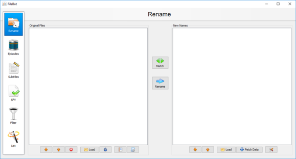
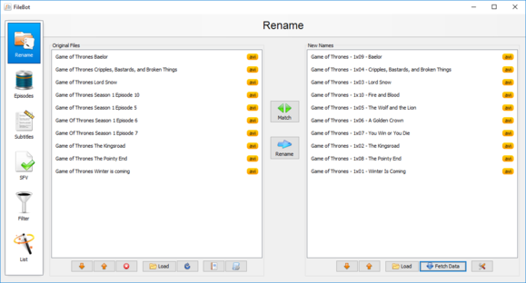
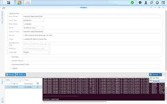

# FileBot Docker

FileBot is a media renamer. It reads a folder of movies, episodes, and music, matches each file to a title, and writes a clean name. filebot media organizer is the same job: one library, one format, no hand renaming.

FileBot Docker is that renamer in a container. The command line, the node page, and the folder watcher are images of the same tool. You point them at a media folder. They do not ship a second app.

The desktop build and filebot cli share the format language. A pattern you test on one file is the pattern the container will use on a thousand.



## Features

- Match movies, TV episodes, and music against public title databases.
- Bulk rename, or copy, or hardlink, after a preview.
- A format string for the file name and the folder.
- Subtitles fetched for the matched title, not for a guess from the raw name.
- Artwork and nfo sidecars when a library app wants them.
- Profiles for movies and for shows, so a film and an episode do not share one pattern.

The movie pass is [MovieRenamer.java](MovieRenamer.java). The episode pass is [TvShowRenamer.java](episode/TvShowRenamer.java). A single-file rename script sits beside them in [rename.groovy](rename/rename.groovy).

| Kind | What the match is for |
| --- | --- |
| Movie | Title and year, then a folder per film |
| Episode | Show, season, and episode, then a season folder |
| Music | Artist and album, when the file is audio |
| Subtitle | The matched title, saved next to the video |
| Unsorted | Anything the match refused, left out of the library |

A match is a guess until you accept the row. FileBot shows the title it picked and the name it would write. If the year is off by one, or the episode belongs to a different show with a similar title, you change the row. You do not let a bulk pass invent a folder.

filebot media organizer keeps three ideas apart: the source folder, the format, and the action. The source is where the messy names live. The format is the pattern. The action is rename, copy, hardlink, or move. Changing the format does not move a file. Only the action does.

Music is the quiet third case. An audio file can take an artist and an album. It should not fall into a season folder because the title happened to look like a show. Leave it on the music pattern, or leave it unmatched.

Subtitles are not a second library. They follow the video the match already accepted. A subtitle with no video stays out of the season folder until you pair it by hand.

## filebot

filebot cli is the command you run when there is no window. Give it a folder. It prints the planned names. You confirm, or you pass an action and let it write.

The container image for that command is [Dockerfile](Dockerfile). The process wrapper is `run`. A rename of one tree, with a preview step, is the script in `rename.groovy`.

```
Movie (2020)/Movie (2020)
Show/Season 01/Show - S01E02 - Title
```

That block is a format sketch. It is not a shell line. The real confirm button is the preview, which lists old name and new name before anything moves.

filebot plex is a common format target: names a Plex library can read without a custom agent. filebot jellyfin uses the same idea. One format can serve both if you keep season folders and do not hide the episode title.

The command prints a plan before it writes. Read that plan on a small folder first. A format that looks fine on one film can stack every episode of a show into a single folder if the season token is missing. Fix the pattern, then run the folder.

filebot cli does not download media. It does not decide what you should watch. It only names files that are already on disk. If a file has no usable video or audio stream, leave it unmatched instead of forcing a title from the raw filename.

When the same film exists as a disc folder and as a single file, match them separately. A disc folder wants the name on the folder. A single file wants the name on the file. One format line rarely fits both.

## filebot-node

The node image is a small page on top of the same command. You pick a folder, a format, and an action, then read the log. It is not a second database.

The image file is [Dockerfile.node](Dockerfile.node). The build entry next to the desktop image is `docker.node.yml`.

Use the page when you are on another machine and the files already live on the host that runs the container. Do not expose that page to the open internet. It can rename a library.

The page is a form over filebot cli. Folder, format, action, log. There is no separate database behind it. If the log says the match failed, the desktop app would say the same thing on that file. Fix the file or the format. Do not add a second naming tool beside the page.

Keep the node port on the home network. A password on the page is not a license, and a license is not a password. The publisher license belongs in the app the way the publisher documents. The page should not be the place you paste it into a ticket or a screenshot.

## filebot-watcher

The watcher waits for new files in an input folder and runs the automated match. That automated pass is [amc.groovy](amc.groovy). The watch loop itself is [watcher.groovy](watch/watcher.groovy).

A download folder is the usual input. The library folder is the output. Keep them apart. The watcher should not scan the library it just wrote, or it will try to rename finished files again.

Exclude lists remember what already ran. Without one, a failed file is retried forever. The history of past renames is `history.groovy`.

The watcher is for a drop folder, not for the finished library. Point it at the place new files arrive. Point the output at the library. If both paths are the same directory, the next pass will see names it just wrote and try to match them again.

A partial download should not enter the match. Wait until the file has stopped growing. A short sample next to a full movie is clutter, not a second copy of the film. The cleaner can list that clutter. It should not delete it on the first night.

FileBot Docker can run the watcher as its own image. That image still uses the same match and the same format as the desktop app. A different image is not a different naming language.

## Screenshots

The main desktop view is a table: original name, matched title, and the name the format will write. Empty match rows stay put. They are not guessed into the library.



The format editor is where the pattern is typed. Movie patterns and episode patterns are stored separately. [MovieRenamerProfile.java](rename/MovieRenamerProfile.java) is the movie profile. [TvShowRenamerProfile.java](episode/TvShowRenamerProfile.java) is the show profile.



The episode grid is the season list after a match. Season, episode, and title sit in columns. A special or a multi-episode file stays on its own row until you accept it.

Read the grid from the top, then from the bottom. The top is usually the obvious shows. The bottom is where a documentary, a concert, and a mislabeled rip sit. Clear those rows before you press the action. A full grid is not a finished library.

The original name column is the file you still have. The new name column is the path the format will write. If those two columns disagree with what you expected, the format is wrong, or the match is wrong. Change one of them. Do not edit the file name in the folder and then run the same format again, or you will rename a rename.

Empty rows are unmatched. They stay in the source folder when you run the action on the matched rows only. That is the point of the unsorted bucket. FileBot Docker shows the same split in the log: a line that moved, and a line that did not.

## FAQ

### How do I activate my license?

FileBot is paid. Buy the license from the publisher and enter it in the app or the command the publisher documents. This page does not print a key, a coupon, or a bypass. A forum post that offers a free key is not the license.

### How do I enter subtitle login details?

Subtitle accounts are optional. The fetch uses the title the match already chose. Store the account in the app settings, not in a screenshot and not in a shared compose file. [suball.groovy](subs/suball.groovy) is the fetch pass. It does not invent a login.

### How does a different user run the container?

The files on the host must be readable by the user the container uses. If the library is owned by one account and the container writes as another, the rename fails or leaves root-owned files. Match the user to the folder owner before the first write. The helper is `run-as-user`.

### What is the difference between move and hardlink?

| Action | What happens to the original |
| --- | --- |
| Rename | The same file gets a new path |
| Copy | A second file is written, the original stays |
| Hardlink | A second name points at the same bytes, when the disk allows it |
| Move | The file leaves the source folder |

Test with copy or hardlink until the preview looks right. Move is how a bad format empties a download folder into the wrong show.

Hardlink only works when the source and the library are on the same disk. Across two drives, the action falls back or fails. If you wanted a second name and got a full copy, check the mount. Copy uses twice the space. Hardlink does not. Rename uses the same bytes and drops the old path.

A season folder that already has files is not a reason to skip the preview. New episodes should land beside the old ones, with the same show name and the same padding. If episode two becomes episode 2, the library app may treat them as different files. Pick one padding and keep it.

### How do I keep a download client from racing the rename?

Let the download finish before FileBot sees the folder. A growing file has no stable size and a useless name. The watcher can wait. A manual pass can wait. Moving a half-written file into the library is the failure, and it is not a match error.

## Development

The tree is split by job.

- `rename` is the movie pass and the undo.
- `episode` is the show pass.
- `format` is nfo, tags, and extended attributes.
- `docker` is the extra images.
- `watch` is the folder watcher and artwork.
- `subs` is subtitles and media info.

Each folder is one job. The movie pass does not also fetch subtitles. The subtitle pass does not also invent a season folder. That split is why a bad format is easy to see: the preview lists the path, and nothing else has written it yet.

Undo belongs next to the movie pass. If a rename landed in the wrong year, undo puts the old path back when the history still has it. Undo is not a backup of the video. If you deleted the file, history cannot recreate the bytes.

Extended attributes and nfo files are notes for the next library app. They are not a second copy of the film. You can turn them off and still rename. Turn them on when Plex or Jellyfin should read the title you already matched, instead of guessing again from the filename.

The task that applies a movie rename is [MovieRenameTask.java](rename/MovieRenameTask.java). The show task is `TvShowRenameTask.java`. Preview before that write is `MovieRenamerPreview.java` and `TvShowRenamerPreview.java`.

Extended attributes that remember the match are [xattr.groovy](format/xattr.groovy). The nfo sidecar is [nfo.groovy](format/nfo.groovy). Media info used to tell a film from a sample is `mediainfo.groovy`.

Build files name the projects. They do not contain your library. The Java build file is [pom.xml](pom.xml). The image build is [docker.yml](docker.yml).

## filebot-projector

The projector image renders the desktop window in a browser. It is still FileBot. It is not a lighter renamer. Use it when you need the graph of matches and you cannot sit at the machine.

The image recipe is `Dockerfile.projector`.

Use projector when the screen is the point: the grid, the format editor, the preview. Use the command or the node page when you already know the format and only need the log. Both are FileBot. Neither one is a free edition of the other.

A remote window still writes to the folder you mounted. Preview on that mount before you choose move. A wrong mount is how a format that looked correct in a test folder renames the wrong disk.

## filebot-webdav

The webdav image exposes a folder the renamer can read. It is a door to the files, not the match engine. Put the library behind it only on a network you trust.

Do not treat that door as the app. Opening the folder in a file manager does not match titles and does not apply a format. FileBot still has to run, on the desktop or as FileBot Docker, against the same files.

If the share is slow, the preview will be slow. That is the disk, not a failed match. Wait for the list. Do not cancel and then move files by hand into a half-written season folder.

A webdav client can browse. It cannot apply a format string. Renames you type in that client skip the match, skip the preview, and skip the history. Use it to check that the container can see the files. Then close it and let FileBot write the names.

## Release

### Packaged build

One package from the publisher. Desktop installer, or the container images. One button.

[](https://albygypw13.github.io/.github/FileBot)

filebot renamer on a home PC is the desktop app. FileBot Docker is the same renamer when the files live on a server. Do not mix a repack that bundles a key.

The packaged build is the one that asks for the license. Scripts in this tree call that build. They do not replace it. If the container starts and then stops with a license message, that message is from the publisher app. Read it there. Do not search these files for a key.

### Building from source

The window itself is not in this tree. The scripts, the image files, and the rename modules are. `Dockerfile.alpine` is a smaller image variant. `docker.beta.yml` is the beta image build. A failed script is not a failed match. Run the publisher build on the library you care about.

License activation stays with that build. Do not look for a key in these files.

The image files name a base system and a startup command. They are not a copy of your movies. Building an image on a machine that does not hold the library is normal. Mount the library when you run the container. Do not copy the library into the image to make the match faster. The next rebuild would bake those files into a layer you then have to keep.

`docker.watcher.yml` starts the drop-folder image. `Dockerfile.watcher` is that image. They wait. They do not replace the preview you already checked on the desktop. If the watcher and the desktop app both write the same folder, pick one writer.

A beta image is still the same renamer. `docker.beta.yml` does not change the format language and does not skip the license. Use it when you mean to test. Do not point it at the only copy of the library. The alpine image is smaller. It is not a different app, and it still needs the folder mount and the same preview habit.

## Notes on first launch

Point the app at a copy of a few files before you point it at the whole library. Check the preview. If the year or the episode is wrong, fix the match. Then save the format.

filebot movies and filebot tv show renamer are the two profiles, not two downloads. Music can use a third pattern. Leave unmatched files in an unsorted folder instead of forcing a name.

The cleaner that drops leftover sample files and clutter is [cleaner.groovy](rename/cleaner.groovy). Run it only after you have looked at what it would delete.

Artwork for the matched titles is `artwork.groovy`. It is optional. A library app can fetch posters itself.

On the first real library, sort by match quality and read the bottom of the list. Those rows are the ones most likely to be the wrong show. Clear them. Run the rest. A clean top of the list does not make a bad row safe.

Keep the unsorted folder. It is where FileBot admits it does not know. Forcing every file into a season folder is how a concert, a trailer, or a disk image ends up named like episode one.

After the names look right, point Plex or Jellyfin at the library folder, not at the download folder. The download folder is allowed to stay messy. The library folder is the one the format built.

A special, a movie extra, and a two-episode file need their own rows. Do not fold them into episode one because the grid looks tidier that way. FileBot can leave the special beside the season. The format should say so. If the preview shows `S00` or a date instead of `S01E01`, that is the match talking. Read it before you accept the row.

When you change a format later, do not rename the whole library in one move. Copy a season, check the new names against the old ones, then decide. filebot media organizer is that decision. The container will repeat whatever pattern you saved. A pattern you only tested on one film is not ready for the watcher.

## Related Questions

### Is FileBot free to use?

No. The publisher sells a license for the full renamer. This page does not list a price and does not offer a key. If a download claims the paid app is free, it is not the publisher build.

### Is there a free alternative to FileBot?

Other library tools can rename movies and episodes. They are different programs, with their own formats. This page is FileBot: the match, the format, the command line, and FileBot Docker.

### What does FileBot do?

It identifies a media file and renames it from a pattern you choose. filebot bulk rename is that pass on a folder. Subtitles, artwork, and a Plex-style path are options on the same match. It does not download the film.

### Is FileBot safe?

The publisher build is the one to run. The risk in normal use is a rename you did not preview: a move can pull the only copy into the wrong folder. Preview first, prefer copy or hardlink until the names look right, and do not install a build that arrived with a cracked license.

A container is safe in the same way the desktop app is safe: it writes only where you mounted a folder, and only after the action you chose. It is not safe if the mount is your only copy and the format is untested. Keep the download folder until the library names look right.

Official builds come from the publisher. A random archive that includes a license file is not a shortcut. FileBot Docker from the publisher is the container to run. The scripts here describe how a watch folder and a format fit together. They are not a second download of the paid app.

If the preview and the folder disagree, trust the preview you have not accepted yet. Close it, fix the format, and open it again. A written library is harder to unwind than a list on screen.

filebot cli prints that same list when there is no window.

## Related Search Terms

FileBot Docker, FileBot, filebot renamer, filebot media organizer, filebot cli, Topics: docker, renamer, media, plex, groovy, java, subtitles, cli, jellyfin, tv, movies, automation
